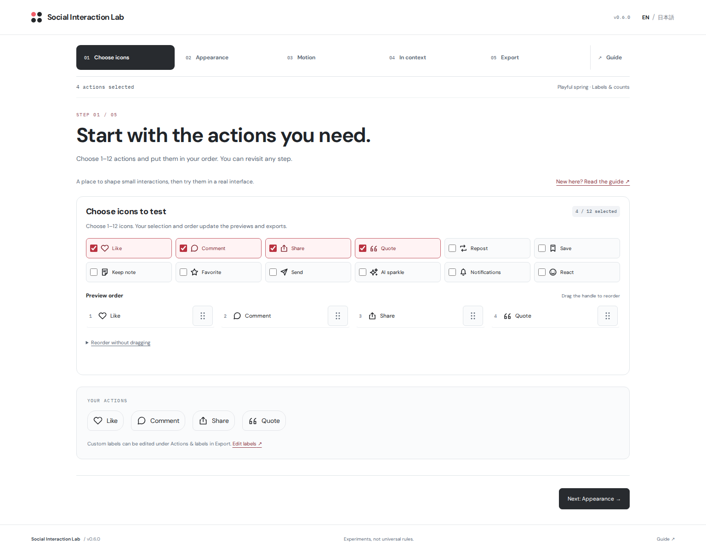
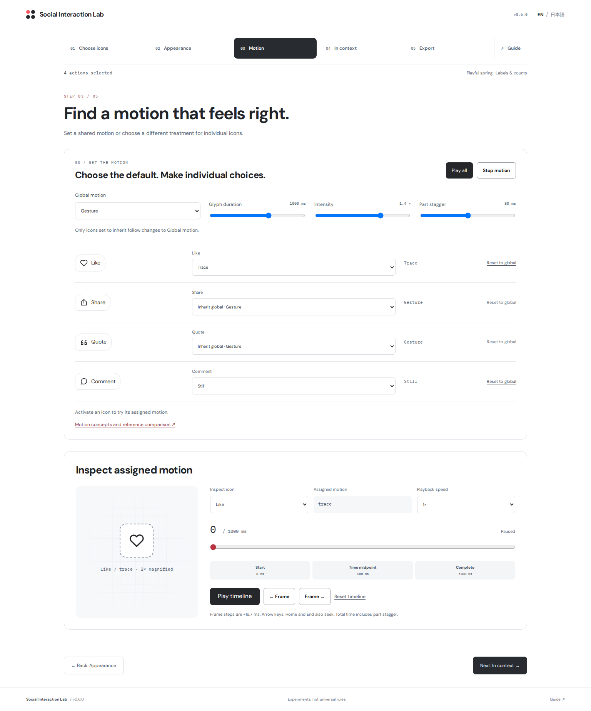

# Social Interaction Lab

**いいね・保存・共有の見た目と動きを選び、その設定を React の実装へ。**

フィード・記事・チャットの操作 UI を作る開発者やデザイナーのための Studio です。アイコンを選び、見た目と動きを調整し、使われる場面で試して、React コンポーネントとして持ち帰れます。5つのタブでひとつの設定を共有するので、気になるところに戻って調整できます。

[English](README.md) · [5つのステップ](docs/STUDIO.md#five-step-workflow) · [ローカルで試す](#ローカルで試す) · [React に組み込む](#react-に組み込む)



必要な操作を選び、その設定を5つのタブへ引き継ぎます。[モバイル・日本語の「使用画面」](docs/screenshots/workflow-context-mobile-ja.png)では、同じ設定のフィードと、独立したローカルの処理状態を試せます。



全体をそろえつつ、必要なアイコンだけ別の動きにできます。下の時間軸で適用結果も確認できます。画像は 0.6.0 を実ブラウザーで撮影したものです。静止画はレイアウトを示し、操作や時間経過の検証は[検証記録](https://github.com/domizo/social-interaction-lab/blob/main/docs/QA.md)で区別して扱います。

## 5つのステップで、設定とコードを持ち帰る

1. **アイコンを選ぶ。** 1〜12種類の操作を選び、ハンドルをドラッグして並べ替えます。同じハンドルでキーボードによる選択・移動・確定・キャンセルも可能です。「ドラッグせずに並べ替える」を開くと「前へ／後ろへ」を使えます。確定した順序はほかのステップでも引き継ぎます。
2. **見た目を整える。** 「見た目の設定を、ひとつの場所で。」にスタイル、表示方法、余白、サイズ、線幅、色、操作領域、プレビューの設定をまとめています。選んだスタイルを確認し、必要なら単変数比較を使えます。
3. **動きを選ぶ。** 全体の動きを選び、アイコンごとに別の動きを指定するか「全体に合わせる」を使います。時間・強さ・パーツの時間差を調整し、選択中の操作のプレビューと時間軸で適用結果を確認できます。
4. **使用画面で試す。** 同じ操作をフィード・記事末尾・固定のチャット回答で確認します。選んだ設定でトグル、ローカル入力フォーム、共有メニューを試せます。
5. **エクスポートする。** 「操作とラベル」で EN/JA の名前を編集し、「ラベルを適用」で反映してから、名前付きプリセットをこのブラウザーに保存し、設定 JSON を読み込み・ダウンロードできます。「React をコピー」または「TSX をダウンロード」で `SocialActions.tsx` を取得し、同じタブから private パッケージをダウンロードしてアプリに組み込みます。

どのタブにも自由に戻れます。順番どおりに完了する必要はなく、各タブではその作業だけを表示します。タブ移動・ブラウザーの戻る／進む・言語切り替えで設定を保持し、ブラウザーの保存領域が使える場合は、検証済みのセッション用設定から再読み込み後も設定・言語・見た目の単変数比較の選択を復元します。タブを離れると動き・処理中のローカル操作・未完了のファイル読み込みを止め、ポップアップを閉じます。トグル状態と入力中の下書きは、画面を再読み込みするまで、戻ったときにも残ります。

**ガイド**は独立した参照エリアです。説明、5表現の動きの比較、全アイコンのカタログ、非同期比較、デザインレンズ、状態の見本をまとめています。動きの参照実験はその場だけに作用し、共有設定を書き換えません。操作や通信はローカルのシミュレーションで、チャットの回答は固定サンプルです。SNS・AI サービスには接続しません。

## こんな判断に使えます

### 記事・フィード・チャットに合う操作列を探す

記事末尾のコンパクトなアイコンのみの表示や、コミュニティ向けのラベル付き操作を比較できます。同じ設定を3つの場面で試してから書き出せます。「ガイド → デザインの見方」のレンズでは、余白・アイコンサイズ・線幅の1項目だけを変えて比較します。左右の操作状態もそろえて確認してください。操作領域や間隔の表示は違いを観察するためのもので、美しさやアクセシビリティを採点する機能ではありません。

### 動きの気になる瞬間を止めて見る

「動き」では、操作時と同じ再生エンジンを使って一時停止・スクラブ・低速再生・コマ送りできます。時間や強さを変えたら、設定を作り直さず「使用画面」に戻って試せます。動きを抑える設定では静止表示になります。時間軸にはそのアイコンに適用中の動きを表示し、割り当ては上の設定で変更します。0.6.0 でも、確定済みのコメント・リポストを含む全60組の形状と時間配分を維持します。

### 通信をつなぐ前に、待ち時間や失敗時の見え方を決める

「ガイド → 非同期の状態」では、独立した「いいね」と「保存」の例で、押した直後に表示を変える楽観的更新と、成功してから変える方式を比較できます。失敗・再試行・中止を試し、表示値と確定値の違いを観察します。操作の伝わり方を検討するローカルなシミュレーションで、実際のバックエンド接続や性能測定は行いません。

## ローカルで試す

Node.js 22.12 以上の 22 系、24 系、26 系と npm が必要です。

```sh
npm ci
npm run dev
```

Vite が表示するローカル URL を開いてください。最初は `#choose` を表示し、`#appearance`・`#animation`・`#preview`・`#export`・`#guide` で各画面を直接開けます。アカウントや API キーは不要です。プレイグラウンドとライブラリをビルドするには、次を実行します。

```sh
npm run build
```

サイトを `dist/`、ESM ライブラリを `package/`、インストール用のアーカイブを `public/downloads/` に生成します。

## React に組み込む

「エクスポート」タブから `social-interaction-lab-react-0.6.0.tgz` をダウンロードするか、`npm run build:package` で生成します。アーカイブを組み込み先の React プロジェクトへコピーし、そのプロジェクト内でインストールしてください。

```sh
npm install ./social-interaction-lab-react-0.6.0.tgz
```

npm レジストリには公開していない private アーカイブです。React 18.2 / 19 が peer dependency として必要で、ESM のみに対応します。CSS は明示的に読み込みます。

Studio で選んだ設定を使う場合は、生成コードを `SocialActions.tsx` として保存し、表示します。

```tsx
import SocialActions from './SocialActions';
import '@social-interaction-lab/react/styles.css';

export default function App() {
  return <SocialActions />;
}
```

個別の部品を組み合わせることもできます。

```tsx
import { useState } from 'react';
import { LikeButton } from '@social-interaction-lab/react';
import '@social-interaction-lab/react/styles.css';

export function PostLike() {
  const [liked, setLiked] = useState(false);
  return (
    <LikeButton label="いいね" selected={liked} variant="soft"
      onClick={() => setLiked(value => !value)} />
  );
}
```

生成コードにはローカルのポップアップ実装を含みます。一方、個別部品の CommentButton・QuoteButton はダイアログ、ShareButton はメニューを開くことを支援技術に伝えますが、ポップアップ自体は作りません。個別部品を使う場合は、対応するポップアップ、フォーカス移動・復帰、キーボード操作、`aria-expanded` / `aria-controls` を利用側で実装してください。動くローカル実装例は `src/app/LiveActions.tsx` にあります。

## 対応範囲と保存されるもの

- **アプリへの組み込み:** 生成コードには、選んだ操作と順序、ラベル、表示方法、トークン、動きを含みます。Studio の設定画面、記事・チャットのサンプル本文、時間軸、非同期比較は出力しません。`onCommand` は同期の通知コールバックです。実際の通信・永続保存・権限・エラー処理は利用側で実装します。
- **作業中の設定:** 操作の選択・順序・適用済みの両言語ラベル・場面・表示方法・見た目・動きは、タブ移動や言語切り替えで保持します。保存領域が使える場合は、検証済みの sessionStorage の設定から、同じタブの再読み込み後に設定・言語・見た目の単変数比較の選択を復元します。不正・利用不可の場合は通知して初期値を使い、利用者の編集までは自動上書きしません。名前付きプリセットとは別で、端末間の同期はありません。
- **その場の操作状態:** トグルのオン／オフと入力中の下書きは、タブを移動しても残り、再読み込みで消えます。タブを離れると処理中のローカル操作と動きを止め、ポップアップを閉じ、未完了のファイル読み込みがあとから設定を変えるのを防ぎます。未適用のラベルは書き出しに含みません。アカウント連携、アクセス解析、SNS・AI 接続、投稿はありません。
- **名前付きプリセットと設定ファイル:** プリセットは最大20件で、このブラウザーの localStorage に保存し、削除するかブラウザーのデータを消すまで残ります。保存は明示的に行い、その後の調整で自動上書きしません。「読み込む」で適用します。設定 JSON はスキーマ v1・最大64 KBで、全項目の検証に成功した場合だけ適用します。不正な入力で現在の設定を変更しません。
- **保存やコピーの失敗:** 保存領域を使えない場合はエラーを示し、保存成功とは表示しません。不正な名前付きプリセットのデータは、明示的に消去するまで残します。コピーに失敗した場合は、コードを選択できる形で表示します。持ち運べる控えが必要なら設定 JSON を保存してください。
- **書き出しの境界:** プリセットと生成コードには操作の選択を保持しますが、トグルのオン／オフ、下書き、処理状態、手動の動き抑制スイッチは含みません。生成コードは OS の動き抑制に対応します。`presentation` がない旧スキーマ v1 のプリセット／JSON はラベル付きに、`motionOverrides` がない場合は空のマップに補完し、全アイコンが全体の動きを継承します。新しい書き出しには、一時的に外した操作も含めて個別の割り当てを保持します。

検証条件、書き出し範囲、観察の進め方は [Studio ガイド](docs/STUDIO.md)を参照してください。

## ライブラリの仕様

### 操作カタログ

- 選択状態を持つ制御トグル: `LikeButton`（いいね）、`BookmarkButton`（ブックマーク）、`NoteButton`（メモを保存）、`StarButton`（スター）、`BellButton`（ベル）
- コマンド: `CommentButton`（コメント）、`ShareButton`（共有）、`QuoteButton`（引用）、`RepostButton`（リポスト）、`SendButton`（送信）、`SparklesButton`（きらめき）、`ReactionButton`（リアクション）
- `ActionButton` と装飾用 SVG の `ActionIcon` で、同じ12種類の `SocialAction` を使えます
- `socialActions` / `toggleActions` / `isToggleAction` と EN/JA の `actionLabels` を公開し、カタログの実装に再利用できます

トグルの `selected` は `aria-pressed` に対応し、選択前後でアクセシブル名を変えません。`NoteButton` は付箋の形をした保存操作の別案です。プレイグラウンドでのラベルは「メモを保存」/ “Keep note” で、文章を入力するエディタではありません。Sparkles に AI 機能はなく、リポストや送信を含むすべての操作はローカルのシミュレーションです。

### アイコンのみで表示する

`presentation="icon-only"` は見えるラベルと件数を隠します。必須の `label` は固定のアクセシブル名と標準の title ヒントに使い、指定した件数はアクセシブルな説明として残します。この prop は任意で、初期値は `"labelled"` です。表示方法だけを変え、トグル／コマンドの動作、フォーカス、最小操作領域、動きは変更しません。

```tsx
<LikeButton label="いいね" presentation="icon-only" count={12} selected={liked}
  onClick={() => setLiked(value => !value)} />
```

既存の `showLabel={false}` はラベルだけを隠す互換動作を保ち、ラベル付き表示なら件数は表示されます。標準の title ヒントの表示はブラウザーに依存し、タッチ操作での発見を保証しません。意味が伝わりにくいアイコンには見えるラベルを使ってください。

### アイコン自体を動かす

見た目の variant とは別に、`iconMotion="pulse"` / `"spring"` / `"trace"` / `"gesture"` / `"cartoon"` を選べます。`"none"` ならアイコンの動きを止めます。「動き」タブで全体の動きとアイコンごとの割り当てを選びます。「全体に合わせる」または「全体へ戻す」は個別指定を削除し、明示的な `none` は全体の変更に関係なく静止させます。操作を一度外して再追加しても個別指定は残ります。実操作、各場面、非同期の例、時間軸、生成 React は同じ規則で動きを決定します。時間・強さ・パーツの時間差は共通です。「ガイド → 動きの比較」で5表現を比較でき、「ガイド → アイコン一覧」は最初に「設定したモーション」を全12操作へ反映します。ガイドで別の動きや時間を試しても共有設定は変えず、ポップアップや外部サービスも起動しません。

```tsx
<LikeButton label="いいね" selected={liked} iconMotion="cartoon"
  motionTokens={{ duration: 560, intensity: 1, stagger: 60 }}
  onClick={() => setLiked(value => !value)} />
```

cartoon では、ハートの小刻みな震えと拡大しながら消える輪郭を表現します。コメントは指定時間の最初の75%で、左下の小さな円から膨らみながら上がり、頂点で基本の吹き出しが完成します。最後の25%で落下し、着地時につぶれ、小さく跳ね返って静止します（初期値560 msでは420 ms＋140 ms）。リポストは従来どおり、元の長方形の経路に沿って一定長の矢印本体が移動します。他のアイコンも操作に合わせた動きを SVG 自体で表現します。心地よさの説明は文脈の中で検証する仮説です。

「見た目 → 表面のホバー・押下の反応」の反応時間・押し込みの深さは、アイコンの動きとは別です。アイコンの時間は 0–1600 ms、強さは 0–2、パーツの時間差は 0–160 ms。開始時の動きは成功を意味しません。処理中はゆっくり反復し、`aria-busy`・`aria-disabled`・重複操作の防止・状況説明で状態を伝え、cartoon の追加バーストは表示しません。独立した処理中の点の装飾はありません。OS 設定と `reducedMotion` で静止しても、処理中の意味・操作防止・状況説明を維持します。装飾エフェクトも再生単位で中止され、操作領域の大きさは変わりません。詳しくは[動きの API・意図・制約](docs/MOTION.md)を参照してください。

Studio の時間軸では選択した操作のアイコンを観察できます。単独の `ActionIcon` SVG を `createGlyphTimeline` が専有して再生します。動作中の `ActionButton` 内の SVG には接続しないでください。合計時間にはパーツの時間差も含みます。公開 API は [API ガイド](docs/API.md)を参照してください。

### 状態と非同期処理

`useAsyncAction<T>()` は run / cancel / reset と status / value / error を返します。1つの hook は1つの操作を所有し、処理中の重複開始を無視します。中止・アンマウント後の古い応答は反映しません。AbortSignal を受け取る処理を渡してください。UI の中止がサーバー側の変更を取り消すわけではありません。

## 設計と運用

- `src/lib/tokens.ts` を共通のトークン定義にし、部品・見本・調整 UI・DTCG 出力に使います
- minimal / soft / solid / spring の4種類。印象の説明は、万人に通じる美の法則ではなく検証する仮説です
- アイコンの大きさと線幅は独立。操作領域の最小44 px は設計上の選択です
- WCAG 2.2 の AA 2.5.8 は最小24 × 24 CSS px で、規定の例外があります
- DTCG 2025.10 はコミュニティグループの仕様で、W3C 勧告ではありません
- 動きを抑える OS 設定に対応。アクセント色変更時はコントラストを再確認してください
- [API](docs/API.md)、[設計](docs/DESIGN.md)、[アクセシビリティ](docs/ACCESSIBILITY.md)、[貢献手順](CONTRIBUTING.md)、[変更履歴](CHANGELOG.md)

## 検証と配布

```sh
npm run check
npm test
npm run build
npm run verify:consumer
npm run verify:generated
npm run verify:archive
```

`verify:archive` は Git HEAD が必要で、そのコミットに記録されたファイルだけを使って検証します。

`verify:consumer` は新しい外部プロジェクトに tarball をインストールし、厳密な NodeNext 型検査、ESM の実行時 import、CSS を確認します。`verify:generated` はビルド済み tarball と既存の依存関係を使い、ラベル付き／アイコンのみ・全操作・単独操作・最大長ラベル・旧形式・混在する動き・未選択操作の個別指定・攻撃的な文字列を含むラベルなど、10設定の EN/JA、計20件の生成 TSX を型検査します。不正な個別指定マップを拒否し、getter や `toJSON` を実行しないことも確認します。ブラウザー検証用に独立した生成コンポーネントのページもビルドします。この QA ページは公開対象に含めません。CI の設定は `.github/workflows/quality.yml` にあります。コマンドや CI の定義が存在することと、実行済み・成功済みであることは別です。ブラウザー検証の実施範囲と結果は [QA 記録](https://github.com/domizo/social-interaction-lab/blob/main/docs/QA.md)を参照してください。

private ソースと private デモです。公開ライセンス決定までは UNLICENSED。npm には公開していません。DOM テストはブラウザのレイアウトや実際の支援技術による確認を代替しません。
