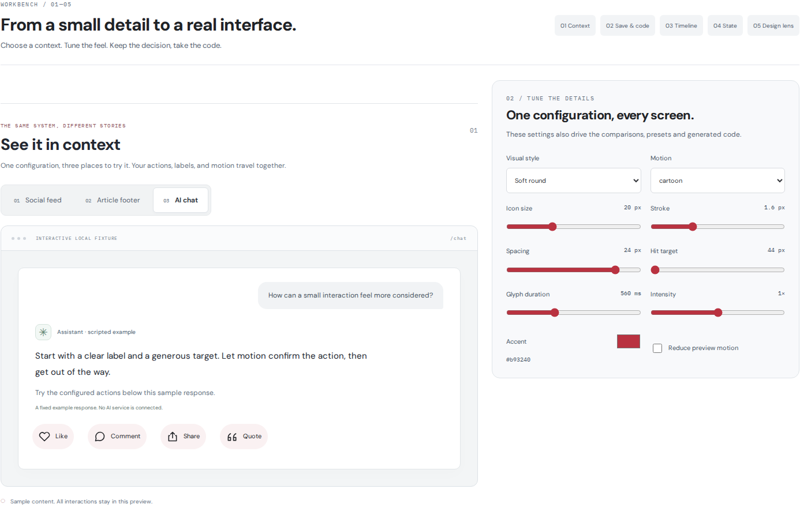

# Social Interaction Lab

Four original visual styles and five glyph-motion treatments for 12 social-action icons, built from shared accessible React + TypeScript primitives. Cartoon motion adds anime-inspired anticipation, squash, overshoot, and decorative effects. Includes a bilingual EN/JA interaction studio, Vite playground, and installable library.

[日本語](README.ja.md)

## Run the playground

Requires Node.js 22.12+, 24, or 26 (supported even-numbered releases) and npm.

```sh
npm ci
npm run dev
npm run check
npm test
npm run build
```

`npm run build` emits the playground in `dist/`, ESM library in `package/`, and a downloadable tarball in `public/downloads/`. There are no accounts, API keys, analytics, social-network or AI connections, or posting. Every request in the playground is local simulation. Drafts, selections, and simulated requests last for the mounted session only; reload clears them. Named Studio presets are the exception: they persist in this browser’s localStorage until deleted or browser data is cleared.

## Use the interaction studio

1. **Try a context.** Switch between a sample social feed, article footer, and scripted AI-chat response. The same action selection, EN/JA labels, labelled/icon-only presentation, variant, tokens, and motion power all three; the chat has no AI backend. Toggle actions, local Comment/Quote drafts, and a fixture Share menu are interactive.
2. **Keep a configuration.** Select 1–12 actions and apply edited labels. Save up to 20 named presets in this browser, or download/import schema-v1 JSON, including the presentation setting. Imports are limited to 64 KB and validated completely before applying; invalid data leaves the current configuration unchanged.
3. **Take the code.** Copy or download a complete `SocialActions.tsx` component with imports, controlled toggles, local composers, a sharing menu, and an optional `onCommand` callback. It carries the configuration and both label languages, using the selected display language. It does not reproduce the entire Studio page. Clipboard failure reveals selectable source.
4. **Inspect time and state.** Scrub any of the 12 icons × five treatments with the shared motion engine, play at 0.25×/0.5×/1×, step about 16.7 ms, and inspect phase markers. Separately compare optimistic and after-success Like/Save updates with local failure, retry, cancellation, and displayed versus confirmed values.
5. **Compare one variable.** The design lens changes spacing, icon size, or stroke width while matching the remaining configuration. Overlays show button bounds, icon-box geometric centers, and same-row horizontal gaps. These measurements support design hypotheses, not automatic judgments of beauty or accessibility.

The shared presentation control defaults to labelled buttons. Choose icon-only to hide visible labels and counts across the contexts, design lens, async comparison, original comparisons, and applicable motion/state specimens. Accessible names, count descriptions, and native title hints remain available. Older schema-v1 presets/JSON without `presentation` load as labelled.

Presets and exports contain configuration, not drafts, selections, request state, or the manual reduced-motion preview switch. The generated component still honors OS reduced motion. Storage failures are reported without claiming a save; invalid stored data is left untouched until you explicitly clear it. See the [Studio guide](docs/STUDIO.md) for validation rules, export scope, and a testing workflow.



[Mobile Japanese rendering](docs/screenshots/studio-context-mobile-ja.png). These are browser captures; still images do not establish animation behavior.

## Install the library

Download `social-interaction-lab-react-0.4.1.tgz` from the playground or build it with `npm run build:package`. In your separate React project:

```sh
npm install ./social-interaction-lab-react-0.4.1.tgz
```

React 18.2 or 19 is a peer dependency. The library is ESM-only; styles are explicitly imported and are not automatically injected.

```tsx
import { useState } from 'react';
import { ActionBar, LikeButton, CommentButton, ShareButton, QuoteButton } from '@social-interaction-lab/react';
import '@social-interaction-lab/react/styles.css';

export function PostActions() {
  const [liked, setLiked] = useState(false);
  return (
    <ActionBar tokens={{ gap: 12, iconSize: 20 }}>
      <LikeButton label="Like" selected={liked} variant="soft"
        onClick={() => setLiked(value => !value)} />
      <CommentButton label="Comment" onClick={() => openYourComposer('comment')} />
      <ShareButton label="Share" aria-expanded={shareMenuOpen}
        onClick={() => openYourShareMenu()} />
      <QuoteButton label="Quote" onClick={() => openYourComposer('quote')} />
    </ActionBar>
  );
}
```

The popup callbacks above are integration placeholders for your application. LikeButton is controlled, as are the other toggle components listed below. CommentButton and QuoteButton announce a dialog; ShareButton announces a menu. You must supply matching accessible popups, keyboard navigation, focus handling, and aria-expanded/aria-controls. The full working popup implementations are in `src/app/LiveActions.tsx` in the source project. The exported primitives do not create popups themselves.

### Explore the action catalog

- Controlled toggles: `LikeButton`, `BookmarkButton`, `NoteButton`, `StarButton`, `BellButton`
- Commands: `CommentButton`, `ShareButton`, `QuoteButton`, `RepostButton`, `SendButton`, `SparklesButton`, `ReactionButton`
- `ActionButton` accepts all 12 `SocialAction` values; `ActionIcon` exposes the same decorative SVG catalog
- Exported `socialActions`, `toggleActions`, `isToggleAction`, and EN/JA `actionLabels` keep catalog integrations consistent

Toggle `selected` values map to `aria-pressed`; keep the accessible label stable. `NoteButton` is a sticky-note alternative for saving, labelled “Keep note” / “メモを保存” in the playground, not a text editor. Sparkles is a local visual action, not an AI service. Repost, Send, and the other catalog actions do not publish or transmit anything.

### Choose icon-only presentation

`presentation="icon-only"` hides both visible text and count while preserving the stable `label` as the accessible name, a native title hint, and an accessible description for a supplied count. The optional prop defaults to `"labelled"`. It changes presentation, not toggle/command behavior, focus handling, hit-target minimums, or motion.

```tsx
<LikeButton label="Like" presentation="icon-only" count={12} selected={liked}
  onClick={() => setLiked(value => !value)} />
```

Existing `showLabel={false}` retains its original label-only behavior: in labelled presentation, the count remains visible. Native title hints are browser-dependent and do not guarantee discovery on touch devices; choose visible labels when the icon may be unfamiliar.

### Animate the icons

Choose `iconMotion="pulse"`, `"spring"`, `"trace"`, `"gesture"`, or `"cartoon"` independently of the visual style; `"none"` disables glyph motion. The Motion section compares the original four actions × five treatments, replays them together, and adjusts glyph duration, intensity, and part stagger. The Studio timeline adds seekable inspection using `createGlyphTimeline` on an exclusively owned standalone `ActionIcon` SVG. Never attach it to an active `ActionButton` SVG. A separate 12-card catalog previews the selected treatment across every icon; those previews do not open popups or invoke a service. Select a treatment to use it in the original live local interactions.

```tsx
<LikeButton label="Like" selected={liked} iconMotion="cartoon"
  motionTokens={{ duration: 560, intensity: 1, stagger: 60 }}
  onClick={() => setLiked(value => !value)} />
```

Cartoon gives the heart a quiver and an expanding, fading outline. Comment rises while growing from a tiny lower-left circle into the standard bubble during the first 75% of its duration, reaching its full contour at the peak. Over the final 25%, it falls, squashes on landing, rebounds mildly, and settles (420 ms + 140 ms at the 560 ms default). Repost continues to slide fixed-length arrow bodies around its original rectangular route. Other icons use action-specific gestures. These expressive treatments are hypotheses to test in context, not universal rules for beauty.

Glyph duration is bounded to 0–1600 ms, intensity to 0–2, and part stagger to 0–160 ms. Activation feedback is not a success message. Pending uses a slower repeating glyph with static dots and accessible status; cartoon secondary bursts stay off during pending. OS/manual reduced motion preserves state without movement. Effects are decorative, cancellation-owned, and never enlarge the hit target. See [motion API and design tradeoffs](docs/MOTION.md).

### Async ownership

```tsx
const request = useAsyncAction<boolean>();
async function like() {
  const next = await request.run(signal => yourAdapter(!liked, signal));
  if (next !== undefined) setLiked(next);
}
// <LikeButton label="Like" selected={liked} pending={request.status === 'pending'} onClick={like} />
// request.cancel() aborts and invalidates outstanding results.
```

Import `useAsyncAction` from the same package. One hook instance owns one action. Repeated activation while pending is ignored. Cancellation protects state even when an adapter ignores its AbortSignal. Keep consequential side effects in the adapter cancellation-aware: cancelling the UI does not undo a remote server mutation.

## Design and maintenance

- `src/lib/tokens.ts` is the versioned runtime source, shared by components, specimens, controls, and DTCG JSON export
- Four variants: `minimal`, `soft`, `solid`, `spring`; see [design hypotheses](docs/DESIGN.md)
- Icon size and CSS-pixel stroke are independent through non-scaling strokes
- 44 px minimum hit targets are a product choice; WCAG 2.2 AA 2.5.8 is 24 × 24 CSS px with exceptions
- OS reduced motion and the standalone `reducedMotion` prop suppress both SVG motion and CSS transforms
- Arbitrary accent changes may reduce contrast; the inspector warns and exports remain experimental
- [API](docs/API.md), [accessibility](docs/ACCESSIBILITY.md), [contribution checklist](CONTRIBUTING.md), [changelog](CHANGELOG.md)

## Verification

```sh
npm test
npm run build
npm run verify:consumer
npm run verify:generated
npm run verify:archive
```

`verify:consumer` creates a fresh external npm project, installs the tarball, typechecks with strict NodeNext and skipLibCheck:false, imports the ESM at runtime, and checks the stylesheet. `verify:generated` compiles generated EN/JA TSX examples against the built archive, including labelled/icon-only, full-catalog, single-action, and maximum-label configurations, using existing dependencies. It also builds a separate generated-component fixture for the browser suite; that QA page is excluded from deployment. `verify:archive` requires a Git HEAD and tests only files in that committed archive. Do not ignore `src/lib/`.

CI is defined in `.github/workflows/quality.yml`; a configured check is not evidence of a passing run. DOM tests cover behavior but do not prove layout, native modal focus trapping, platform assistive-technology compatibility, or visual contrast on all custom surfaces. Browser checks and their status are recorded in the [QA guide](https://github.com/domizo/social-interaction-lab/blob/main/docs/QA.md). Test your real integration.

## Distribution

Private source and private demo. `UNLICENSED` until a public license is chosen; package metadata has `private: true`. Nothing is published to npm. Third-party dependency licenses apply separately.
